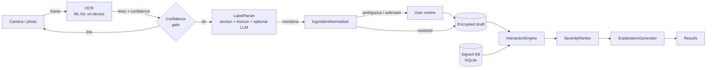

<h1 align="center">AirGap Rx</h1>

<p align="center">
  <b>An offline drug and supplement interaction checker for Android.</b><br>
  Photograph a label. Find interactions. Nothing leaves your phone.
</p>

<p align="center">
  
  
  
  
</p>

<!-- Replace OWNER/REPO above once the repository exists. Add a demo GIF here: docs/media/demo.gif -->
<p align="center"><i>Demo GIF and screenshots go here (docs/media/)</i></p>

> **Not medical advice.** AirGap Rx is a university prototype (AUT COMP826, Milestone 2). It gives
> information only. Do not stop or change any medicine without talking to a pharmacist or prescriber.

## Contents

- [Why](#why)
- [Features](#features)
- [How it works](#how-it-works)
- [Requirements](#requirements)
- [Install and run](#install-and-run)
- [Using the app](#using-the-app)
- [Testing and evaluation](#testing-and-evaluation)
- [Knowledge base](#knowledge-base)
- [Project structure](#project-structure)
- [Limitations](#limitations)
- [Licence and acknowledgements](#licence-and-acknowledgements)

## Why

About half of adults take at least one dietary supplement, and the people who take the most supplements
are often also the people taking several prescription medicines (Kantor et al., 2016). Online interaction
checkers send your full medicine list to a server, and they cover herbal and supplement ingredients unevenly.

AirGap Rx moves the whole check onto the phone. The app **declares no network permission**, so Android
itself stops it from opening a connection. You don't have to trust a privacy policy; you can check the
APK yourself.

## Features

| | Feature | Requirement (M1) |
|---|---|---|
| 📷 | **Label capture** with on-device OCR (CameraX + bundled ML Kit). Poor captures ask for a retake and nothing is guessed. | R2 |
| 🔎 | **Ingredient recognition** using an ingredient-section parser, fuzzy lexicon spotting and an optional on-device language model | R2, R3 |
| ❓ | **Review and disambiguation**: near-misses ("warfarn") and unknown actives ("ashwagandha") always go to the user to decide | R3 |
| 💊 | **Encrypted medication shelf**: SQLCipher, with the key wrapped by Android Keystore | R8 |
| ⚠️ | **Pairwise interaction check** covering prescription medicines, OTC products, supplements, herbs and foods | R4, R6 |
| 🚦 | **Severity ranking**: Major interactions interrupt and must be acknowledged. Minor ones are collapsed. | R5 |
| 🔁 | **Duplicate ingredient warning** when the same active ingredient appears in two products (e.g. two paracetamol products) | R5 |
| 📚 | **Signed, versioned knowledge base**: shows release, compile date and SHA-256, and accepts offline updates from a file | R4 |
| 🛡️ | **EgressGuard**: the app refuses to run if a build ever declares a network permission | R1 |

## How it works



The architecture is **MVVM** (Jetpack Compose views → ViewModels → domain services). All domain logic
lives in a pure-Kotlin `:core` module that has no Android dependencies, so it can be unit-tested on any
machine. See [`docs/ARCHITECTURE.md`](docs/ARCHITECTURE.md) for the component, class, sequence and
deployment views.

## Requirements

| | Minimum |
|---|---|
| Phone | Android 10 (API 29) or later, 4 GB RAM, rear camera with autofocus |
| Build | Android Studio Ladybug (2024.2) or newer, JDK 17+ (Android Studio's bundled JDK works) |
| Knowledge base tools | Python 3.9+, `pip install cryptography` |

## Install and run

### Option A: install the APK

1. Download `app-release.apk` from the latest [GitHub release](../../releases) or from the **Actions** build artifacts.
2. On the phone, allow installs from your browser or file manager, then open the APK.
3. Open **AirGap Rx**. When asked, allow camera access. That is the only permission the app requests.

### Option B: build from source

```bash
git clone https://github.com/OWNER/REPO.git
cd REPO

# 1. (Optional) rebuild the knowledge base. A signed development KB is already bundled.
pip install cryptography
python kb/build_kb.py

# 2. Run the domain unit tests (no device needed)
./gradlew :core:test

# 3. Build and install on a connected phone or emulator
./gradlew :app:installDebug
```

Or open the folder in Android Studio, wait for Gradle sync, select the `app` configuration and press **Run ▶**.

> **Windows:** use `gradlew.bat` instead of `./gradlew`.

### Optional: on-device language model

The rule-based parser works without a model. To try the language-model parser, download a MediaPipe
`.task` model (for example Gemma 3 1B int4) **on your computer**, copy it to the phone, then go to
**ⓘ → Label-reading model → Import .task model**. The app copies the file into private storage. It
never downloads anything itself.

## Using the app

1. **My medicines** is the home screen. Tap **Scan a label**.
2. Fill the frame with the ingredients panel and tap the shutter. You can also choose a photo, or add a medicine by name.
3. **Check what was read**: confirm each ingredient, choose the right one where the app isn't sure, and decide what to do with anything not in the knowledge base. Saving stays disabled until every item is resolved.
4. Add all your products, then tap **Check interactions**.
5. Major interactions show a dialog first. Tap any result to see why it happens, what to do, and where the information comes from.
6. **ⓘ** shows the knowledge-base version and checksum, confirms the app has no network permission, and lets you install a KB update from a file.

## Testing and evaluation

| Command | What it checks |
|---|---|
| `./gradlew :core:test` | 29 JVM unit tests: text normalisation, fuzzy matching, parser (incl. excipient filtering), normaliser escalation, ranking, duplicate detection, KB signature, checksum, downgrade and tamper rejection |
| `./gradlew :app:verifyNoNetworkPermissionRelease` | Fails if any network permission survives manifest merging (R1) |
| `scripts/check_apk_permissions.sh <apk>` | Lists the APK's permissions with `aapt2` and fails on any network permission (R1) |
| `python kb/build_kb.py && ./gradlew :core:evaluate` | Criteria 4 and 5: normalisation accuracy and detection recall against the compiled KB |
| `./gradlew :app:connectedDebugAndroidTest` | Criteria 2, 3 and 8 on a device: OCR character accuracy, retake handling, latency and memory |

GitHub Actions runs the unit tests, both manifest checks, the APK build and the `aapt2` check on every push.
The full evaluation plan is in [`docs/evaluation/`](docs/evaluation/README.md).

## Knowledge base

| Source | Used for | Licence |
|---|---|---|
| [DDInter](https://ddinter.scbdd.com/) (Xiong et al., 2022; Tian et al., 2025) | Drug–drug pairs with severity | CC BY-NC-SA 4.0 |
| Curated supplement table (`kb/sources/supplement_interactions.csv`) | Herbal, supplement and food interactions, each with a cited source | see [`REFERENCES.md`](kb/sources/REFERENCES.md) |
| RxNorm (optional) | Ingredient identifiers (RxCUI) and US brand names | NLM terms |
| `synonyms.csv` | NZ brand names (Marevan, Eltroxin, Cartia…) and Latin names | project |

The repository includes a **development KB**. Its drug–drug pairs come from a small fixture labelled
`DEV-FIXTURE`. To build the real KB, download the DDInter CSVs into `kb/sources/ddinter/` and run
`python kb/build_kb.py --release`. See [`kb/README.md`](kb/README.md).

## Project structure

```
├── app/                         Android app (MVVM, Jetpack Compose)
│   └── src/main/kotlin/com/airgaprx/app/
│       ├── ui/                  Views + ViewModels: shelf, capture, review, results, kb (about)
│       ├── data/                KnowledgeBaseRepository, MedicationRepository (SQLCipher), SqliteKnowledgeBase
│       ├── platform/            MlKitOcrService, MediaPipeLlmParser, EgressGuard, KeystorePassphrase
│       └── AppContainer.kt      Manual dependency wiring
├── core/                        Pure-Kotlin domain layer, no Android dependencies
│   └── src/main/kotlin/com/airgaprx/core/
│       ├── recognition/         LabelParser, LexiconLabelParser, HybridLabelParser
│       ├── normalise/           Text, Lexicon (trigram index), IngredientNormaliser
│       ├── reasoning/           InteractionEngine, SeverityRanker, ExplanationGenerator
│       ├── kb/                  KnowledgeBase, KbVerifier, KbInstaller (signed packages)
│       └── pipeline/            RecognitionPipeline, timings
├── kb/                          Knowledge-base compiler + curated sources
├── docs/                        Architecture, UML, evaluation kit
├── scripts/                     APK permission check
└── .github/workflows/           CI
```

## Limitations

- Android only (a deliberate trade-off, see M1 Section 3.4).
- Coverage is limited to the compiled sources. The most complete commercial compendia can't be redistributed, so they can't be used offline.
- The curated supplement table is a draft until every row is reviewed against its source (`reviewed=yes`).
- No dose-level checking, pharmacogenomics or clinician workflows (out of scope, M1 Section 1.2).
- Interaction severity is shown as the source records it. It has not been clinically validated for this app.

## Licence and acknowledgements

Code: MIT. Compiled knowledge-base data that includes DDInter: CC BY-NC-SA 4.0 (non-commercial).

Built by Hossein Mohseni Mofrad for COMP826 Mobile Systems Development, Auckland University of Technology.
Claude (Anthropic) was used as a coding assistant. See the AI-use statement in the report.
