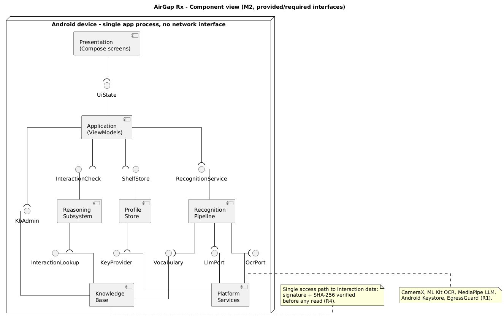
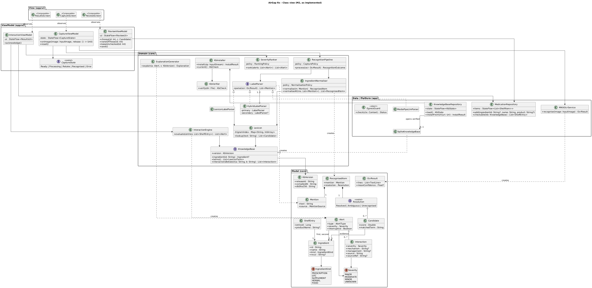
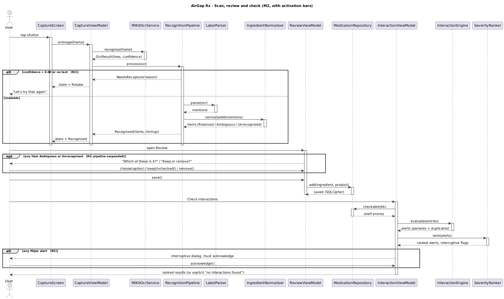
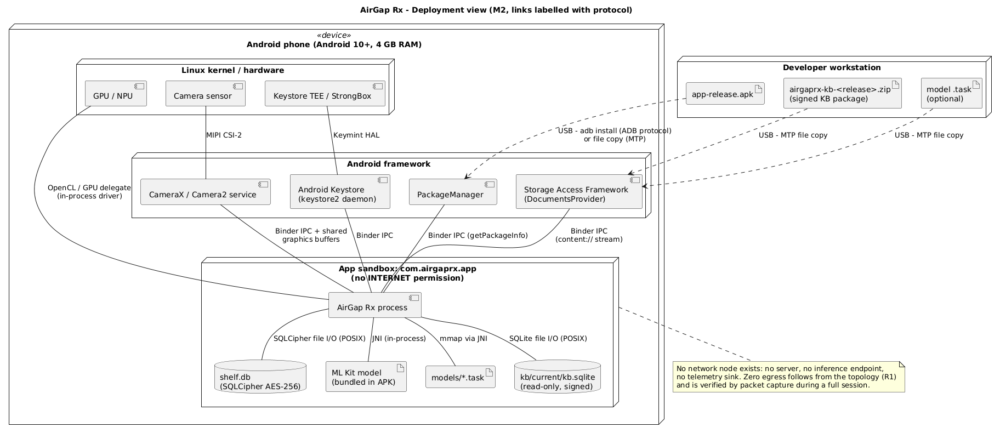

# Architecture

These are the Milestone 1 views, updated to match the code as built. Diagram sources are in
`docs/uml/*.puml` (PlantUML). Re-render them with `java -jar plantuml.jar -tpng docs/uml/*.puml`.

## Logical view

**Pattern: MVVM.** Compose screens observe immutable `StateFlow`s exposed by ViewModels. ViewModels
hold no reference to views and coordinate domain services. The domain layer lives in a separate,
pure-Kotlin `:core` Gradle module, so the compiler enforces the layer boundary: `:core` cannot import
Android classes.

Component diagram changes from M1, following marker feedback:

- Connections between components now use provided (ball) and required (socket) interfaces.
- The diagram stays at component level. ViewModels and screens appear only in the class view.

`CaptureState`, `RecognisedItem`, `Alert` and `Ingredient`, which M1 left undefined, are now fully
specified. Associations match the properties in the code.

## Process view

The sequence diagram now has activation bars. The two intervention points, re-capture (R2) and
disambiguation (R3), are `alt`/`opt` fragments. A Major alert is a third, interruptive point (R5).

Navigation follows the M1 state machine (Figure 7): Shelf → Capture (self-loop on retake) → Review
(suspends until every item is resolved) → Shelf → Results → Alert detail.

## Physical view

Connections are now labelled with the protocol used (Binder IPC, JNI, POSIX file I/O, MTP/ADB), not
the function they serve. No network node appears anywhere in the deployment.

## Design changes since Milestone 1 (for the reflection section)

| M1 plan | As built | Why |
|---|---|---|
| NNAPI delegate for the parsing model | MediaPipe LLM Inference (GPU via OpenCL, CPU fallback), and the model is optional | NNAPI is deprecated from Android 15. MediaPipe LLM Inference is itself now in maintenance mode, with LiteRT-LM as its successor. |
| Language model as the main parser | Deterministic parser first (ingredient section + lexicon); the language model only proposes extra names, and every proposal still goes through the normaliser | Safety: the model can't invent an ingredient. Testability: the deterministic path is covered by unit tests. |
| SQLite FTS5 for ingredient search | In-memory trigram index (`Lexicon`) | The framework SQLite build doesn't guarantee FTS5. The vocabulary is small, and the index can be tested on the JVM. |
| Single Android module | `:app` + pure-Kotlin `:core` | The compiler enforces the MVVM domain boundary, and the 29 domain tests run without a device. |
| R1 checked by reading the manifest | Merged-manifest Gradle check + `aapt2` APK check + runtime EgressGuard + packet capture | ML Kit's dependencies add INTERNET through manifest merging, so the source manifest alone gives a false sense of safety. |
| (not planned) | Duplicate-ingredient alert | The same active ingredient in two products (e.g. paracetamol) is a common overdose route, and it falls out of the shelf model at no extra cost. |
| (not planned) | Excipient filtering in the parser | Excipients such as magnesium stearate or iron oxide would otherwise raise false magnesium or iron interactions. |
